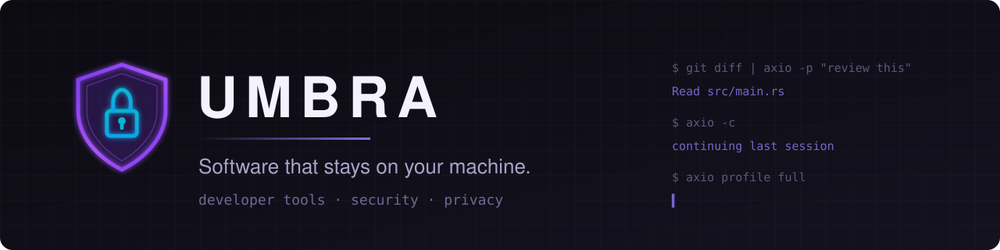
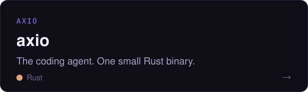
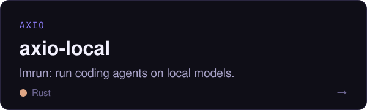
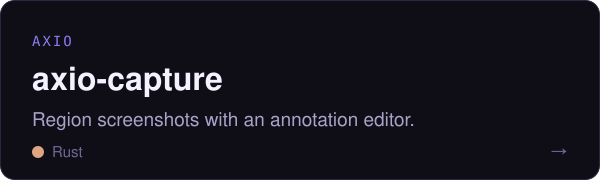
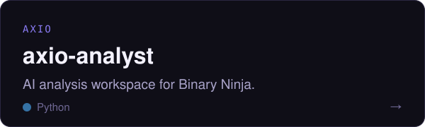

Umbra is an independent software studio founded by [@notzenco](https://github.com/notzenco). We make developer tools, security tooling and privacy apps that run locally, keep your data where it is, and ask before they act.

### Axio

Also: [`axio-sh`](https://github.com/umbra-me/axio-sh) (the [axio.sh](https://axio.sh) website and install scripts)

### In the works

Security and privacy tools, released here as they're ready.

### More

- **Security reports:** use the contact on [umbra.me](https://umbra.me), not public issues
- **Contributing:** issues and pull requests are welcome on any public repository

---

[umbra.me](https://umbra.me) · [axio.sh](https://axio.sh) · [@notzenco](https://github.com/notzenco)
